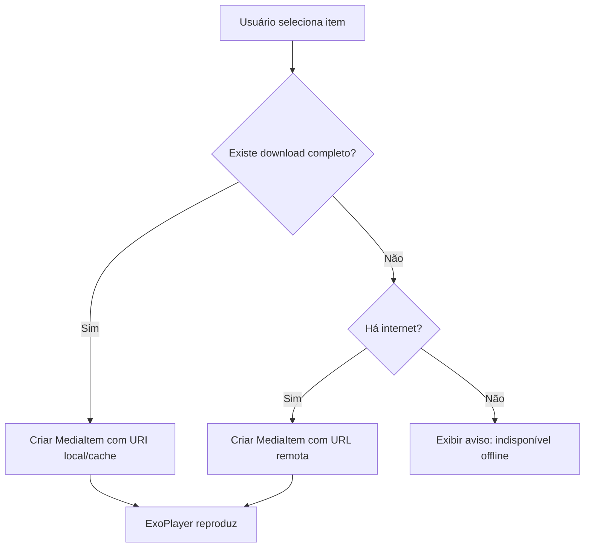

# MobileTV Android com Download e Reprodução Offline

> Documento de especificação e plano de implementação para um app Android inspirado no [iptvnator](https://github.com/4gray/iptvnator), com o diferencial de **baixar conteúdo e assistir offline**.

---

## 1. Visão geral

### 1.1 Objetivo
Criar um player IPTV nativo para Android que gerencie playlists (M3U/M3U8, Xtream Codes e, opcionalmente, Stalker Portal), exiba guia de programação (EPG) e permita **baixar filmes, episódios e gravar transmissões** para assistir sem internet.

### 1.2 Referência: o que o iptvnator oferece
O iptvnator é um app desktop/web (Angular + Electron). Funcionalidades a serem replicadas no mobile:

- Importação de playlists por URL, arquivo local ou texto (M3U/M3U8)
- Suporte a Xtream Codes API
- Suporte a Stalker Portal (opcional / fase posterior)
- Múltiplas playlists
- Agrupamento de canais por categoria (`group-title`)
- Busca de canais
- Favoritos
- EPG (XMLTV)
- Histórico / continuar assistindo
- Player integrado (HLS) e opção de player externo
- Temas claro/escuro
- Internacionalização (i18n)

### 1.3 Diferencial: modo offline
| Funcionalidade | Descrição |
|---|---|
| Download de VOD | Filmes e episódios de séries baixados para o aparelho |
| Download em fila | Múltiplos downloads com pausa, retomada e prioridade |
| Gravação de lives | Gravar um canal ao vivo por duração definida (ou agendada) |
| Reprodução offline | Player usa o arquivo local automaticamente se existir |
| Gerenciador de downloads | Espaço usado, progresso, exclusão, limpeza automática |
| Opções de rede | Baixar só em Wi-Fi, limitar velocidade, retomar após queda |

### 1.3.1 Requisito central: assistir normalmente (online) **ou** offline

O app deve funcionar de forma **híbrida**: o usuário assiste com ou sem internet. Para ficar offline **não é necessário ativar o modo avião do celular**: o app tem um **toggle "Ficar offline"** próprio (ver seção 6.6.1). No modo automático (toggle desligado), o app decide sozinho conforme a rede disponível.

| Situação | Comportamento esperado |
|---|---|
| Com internet, item **não** baixado | Reproduz em streaming normalmente (ao vivo, filmes, séries) |
| Com internet, item **baixado** | Reproduz o arquivo local (mais rápido, sem gastar dados) — com opção "Forçar streaming" |
| **Sem** internet, item baixado | Reproduz normalmente pelo arquivo local |
| **Sem** internet, item não baixado | Mostra aviso "Indisponível offline" e sugere itens baixados |
| Toggle **"Ficar offline" ligado** (com ou sem internet) | App ignora a rede: só mostra e reproduz conteúdo baixado/gravado, sem nenhuma requisição de rede |
| Internet cai durante o streaming | Tenta reconectar; se o item estiver baixado, oferece continuar do mesmo ponto offline |
| Internet cai durante o download | Pausa e retoma automaticamente ao reconectar |

Regras de implementação:
- Um único player (Media3 ExoPlayer) para os dois modos, configurado com `CacheDataSource`: se o conteúdo está no cache de downloads, lê local; senão, busca na rede.
- A decisão online/offline é automática, baseada em `DownloadManager` (status `COMPLETED`) + estado da rede (`ConnectivityManager.NetworkCallback`).
- Progresso de "continuar assistindo" é compartilhado entre streaming e arquivo baixado (mesmo `contentId`).
- Canais **ao vivo** só funcionam online; offline ficam disponíveis apenas as **gravações** feitas antes.
- A interface mostra um ícone de "baixado" nos itens e mantém a navegação funcional offline com os dados em cache (playlists, categorias, capas, EPG).

Critérios de aceitação:
- [ ] Com Wi-Fi/dados ligados, qualquer item da playlist toca em streaming sem precisar baixar
- [ ] Ao ligar o toggle "Ficar offline" (mesmo com Wi-Fi/dados ativos), um filme baixado toca normalmente
- [ ] Com o toggle ligado, o app não faz nenhuma requisição de rede (nem EPG, nem sync, nem imagens remotas)
- [ ] Ao desligar o toggle, o app volta ao streaming sem reiniciar
- [ ] Ao ligar o modo avião do sistema (sem usar o toggle), o app também entra em modo offline automaticamente
- [ ] O mesmo item baixado toca nos dois cenários mantendo a posição de reprodução

### 1.4 Aviso legal (obrigatório no app)
- O app é **apenas um player**: não fornece nem hospeda playlists ou conteúdo.
- O usuário é responsável por usar apenas fontes que tenha direito de acessar e **baixar/gravar**.
- Exibir termo de uso no primeiro acesso e aceitar antes de adicionar playlists.
- Para publicação na Google Play, revisar a política de conteúdo (apps IPTV sem conteúdo embutido costumam ser aceitos, mas o recurso de download exige cuidado extra).
- Não incluir nenhuma playlist pré-carregada.

---

## 2. Stack tecnológica

| Camada | Tecnologia |
|---|---|
| Linguagem | Kotlin |
| UI | Jetpack Compose + Material 3 |
| Arquitetura | MVVM + Clean Architecture (UI / Domain / Data) |
| Injeção de dependência | Hilt |
| Player | **AndroidX Media3 (ExoPlayer)** |
| Download | **Media3 `DownloadManager` + `DownloadService`** (HLS/DASH/progressivo) |
| Tarefas em background | WorkManager (EPG, sincronização, agendamento de gravações) |
| Banco de dados | Room (SQLite) |
| Preferências | DataStore |
| Rede | Retrofit + OkHttp + Kotlinx Serialization |
| Imagens | Coil |
| Paginação | Paging 3 (listas grandes de canais) |
| Navegação | Navigation Compose |
| Testes | JUnit5, MockK, Turbine, Compose UI Test |
| Min SDK | 24 (Android 7.0) |
| Target SDK | Última estável |

> **Por que Media3 para downloads?** Ele já resolve download de HLS (segmentos `.ts`/`.m4s`), cache, retomada, notificações em primeiro plano e reprodução a partir do cache, sem reinventar a roda.

---

## 3. Arquitetura

### 3.1 Estrutura de módulos
```
app/
├── core/
│   ├── common/          # utilitários, Result, dispatchers
│   ├── database/        # Room (entities, DAOs)
│   ├── network/         # Retrofit, OkHttp, interceptors
│   ├── datastore/       # preferências
│   └── designsystem/    # tema, componentes Compose
├── feature/
│   ├── playlists/       # gerenciar playlists
│   ├── live/            # canais ao vivo + EPG
│   ├── vod/             # filmes
│   ├── series/          # séries e episódios
│   ├── player/          # tela do player
│   ├── downloads/       # fila, biblioteca offline, gravações
│   ├── favorites/
│   ├── search/
│   └── settings/
└── parser/
    ├── m3u/             # parser M3U/M3U8
    ├── xtream/          # cliente Xtream Codes
    └── epg/             # parser XMLTV
```

### 3.2 Fluxo de dados
```
UI (Compose) → ViewModel → UseCase → Repository → [Room | Rede | Media3 Downloads]
```

### 3.3 Diagrama de reprodução (online vs offline)


---

## 4. Modelo de dados (Room)

```kotlin
@Entity data class PlaylistEntity(
    @PrimaryKey(autoGenerate = true) val id: Long = 0,
    val name: String,
    val type: PlaylistType,        // M3U_URL, M3U_FILE, XTREAM, STALKER
    val url: String?,
    val username: String?,         // Xtream (armazenar criptografado)
    val password: String?,         // Xtream (armazenar criptografado)
    val epgUrl: String?,
    val lastSyncAt: Long?
)

@Entity data class ChannelEntity(
    @PrimaryKey val id: String,    // hash(playlistId + streamUrl)
    val playlistId: Long,
    val name: String,
    val logoUrl: String?,
    val groupTitle: String?,
    val streamUrl: String,
    val tvgId: String?,
    val contentType: ContentType,  // LIVE, MOVIE, EPISODE
    val isFavorite: Boolean = false
)

@Entity data class DownloadEntity(
    @PrimaryKey val id: String,    // mesmo id usado no Media3 DownloadRequest
    val channelId: String,
    val title: String,
    val posterUrl: String?,
    val sourceUrl: String,
    val localPath: String?,
    val status: DownloadStatus,    // QUEUED, DOWNLOADING, PAUSED, COMPLETED, FAILED
    val bytesDownloaded: Long,
    val totalBytes: Long,
    val percent: Float,
    val createdAt: Long,
    val completedAt: Long?,
    val errorMessage: String?
)

@Entity data class RecordingEntity(
    @PrimaryKey(autoGenerate = true) val id: Long = 0,
    val channelId: String,
    val title: String,
    val scheduledStart: Long,
    val durationMinutes: Int,
    val status: RecordingStatus,   // SCHEDULED, RECORDING, DONE, FAILED
    val filePath: String?
)

@Entity data class EpgProgramEntity(
    @PrimaryKey(autoGenerate = true) val id: Long = 0,
    val channelTvgId: String,
    val title: String,
    val description: String?,
    val start: Long,
    val end: Long
)

@Entity data class WatchProgressEntity(
    @PrimaryKey val contentId: String,
    val positionMs: Long,
    val durationMs: Long,
    val updatedAt: Long
)
```

---

## 5. Funcionalidades detalhadas

### 5.1 Playlists
- [ ] Adicionar playlist por URL M3U/M3U8
- [ ] Importar arquivo `.m3u` local (Storage Access Framework)
- [ ] Adicionar conta Xtream Codes (servidor, usuário, senha)
- [ ] Editar, renomear, excluir e atualizar playlist
- [ ] Atualização automática periódica (WorkManager)
- [ ] Validação de URL e tratamento de erros (timeout, 401, formato inválido)
- [ ] Parser em streaming para playlists grandes (50k+ itens) sem estourar memória

### 5.2 Xtream Codes API
Endpoints principais:
```
GET {server}/player_api.php?username=U&password=P                       # info da conta
GET ...&action=get_live_categories
GET ...&action=get_live_streams
GET ...&action=get_vod_categories
GET ...&action=get_vod_streams
GET ...&action=get_vod_info&vod_id=ID
GET ...&action=get_series_categories
GET ...&action=get_series
GET ...&action=get_series_info&series_id=ID
GET {server}/xmltv.php?username=U&password=P                            # EPG
```
Formato das URLs de stream:
```
Live:     {server}/live/{user}/{pass}/{stream_id}.m3u8   (ou .ts)
Filme:    {server}/movie/{user}/{pass}/{stream_id}.{ext}
Episódio: {server}/series/{user}/{pass}/{episode_id}.{ext}
```

### 5.3 Navegação e descoberta
- [ ] Abas: **Ao vivo / Filmes / Séries / Downloads / Favoritos**
- [ ] Categorias com contagem de itens
- [ ] Busca global com debounce
- [ ] Favoritos persistidos
- [ ] Continuar assistindo (progresso salvo a cada ~10 s)
- [ ] Recentes

### 5.4 EPG
- [ ] Parser XMLTV (streaming, `XmlPullParser`)
- [ ] Mapeamento por `tvg-id`
- [ ] "Agora / Próximo" na lista de canais
- [ ] Grade de programação completa por canal
- [ ] Limpeza de programas antigos (> 24 h)
- [ ] Sincronização em background

### 5.5 Player
- [ ] Media3 ExoPlayer com HLS, DASH, MP4, MKV, TS
- [ ] Controles: play/pause, seek, velocidade, trocar faixa de áudio/legenda
- [ ] Gestos: brilho, volume, duplo toque para avançar/voltar
- [ ] Picture-in-Picture
- [ ] Rotação e tela cheia
- [ ] Troca rápida de canal (zapping)
- [ ] Legendas externas (SRT/VTT)
- [ ] Opção de abrir em player externo (VLC / MX Player) via `Intent`
- [ ] Cast (Google Cast) — fase posterior
- [ ] Suporte a Android TV / D-pad — fase posterior

---

## 6. Módulo de Download e Offline (núcleo do diferencial)

### 6.1 O que pode ser baixado
| Tipo | Baixável? | Estratégia |
|---|---|---|
| Filme (VOD) | Sim | Download direto (MP4/MKV) ou HLS via Media3 |
| Episódio de série | Sim | Idem; opção "baixar temporada" |
| Canal ao vivo | Não (é fluxo contínuo) | **Gravação** por duração (seção 6.5) |
| Fonte com DRM / token expirável | Não garantido | Detectar falha e informar o usuário |

### 6.2 Componentes
```kotlin
// 1. Cache e DownloadManager (singleton via Hilt)
@Provides @Singleton
fun provideDownloadCache(@ApplicationContext ctx: Context, db: DatabaseProvider): Cache =
    SimpleCache(
        File(ctx.getExternalFilesDir(null), "downloads"),
        NoOpCacheEvictor(),
        db
    )

@Provides @Singleton
fun provideDownloadManager(
    @ApplicationContext ctx: Context,
    db: DatabaseProvider,
    cache: Cache,
    httpFactory: DataSource.Factory
): DownloadManager =
    DownloadManager(ctx, db, cache, httpFactory, Executors.newFixedThreadPool(3)).apply {
        maxParallelDownloads = 3
    }

// 2. Serviço em primeiro plano
class AppDownloadService : DownloadService(
    NOTIFICATION_ID, DEFAULT_FOREGROUND_NOTIFICATION_UPDATE_INTERVAL,
    CHANNEL_ID, R.string.downloads_channel, 0
) {
    override fun getDownloadManager() = /* injetado */
    override fun getScheduler() = PlatformScheduler(this, JOB_ID)
    override fun getForegroundNotification(
        downloads: List<Download>, notMetRequirements: Int
    ) = /* notificação com progresso */
}

// 3. Iniciar um download
val request = DownloadRequest.Builder(contentId, Uri.parse(url))
    .setMimeType(MimeTypes.APPLICATION_M3U8) // ou null p/ progressivo
    .build()
DownloadService.sendAddDownload(ctx, AppDownloadService::class.java, request, false)
```

### 6.3 Reprodução a partir do download
```kotlin
val cacheDataSourceFactory = CacheDataSource.Factory()
    .setCache(downloadCache)
    .setUpstreamDataSourceFactory(httpDataSourceFactory)
    .setCacheWriteDataSinkFactory(null) // somente leitura ao reproduzir

val mediaSourceFactory = DefaultMediaSourceFactory(cacheDataSourceFactory)
val player = ExoPlayer.Builder(ctx).setMediaSourceFactory(mediaSourceFactory).build()
```
Com isso, se o item está no cache, ele toca **sem rede**; se não, busca online normalmente.

### 6.4 Requisitos funcionais de download
- [ ] Botão "Baixar" em filmes e episódios (e "Baixar temporada")
- [ ] Fila com no máximo N downloads simultâneos (configurável, padrão 2–3)
- [ ] Pausar / retomar / cancelar individualmente e em lote
- [ ] Retomada automática após queda de rede ou reinício do app
- [ ] Notificação com progresso e ações (pausar/cancelar)
- [ ] Restrição "somente Wi-Fi" (`Requirements.NETWORK_UNMETERED`)
- [ ] Restrição de bateria / carregando (opcional)
- [ ] Verificação de espaço livre antes de iniciar
- [ ] Escolha do local de armazenamento (interno / cartão SD)
- [ ] Seleção de qualidade quando a fonte HLS oferecer múltiplas variantes
- [ ] Indicador de "baixado" nos cards de conteúdo
- [ ] Tela **Downloads**: lista, progresso, tamanho total, excluir, "limpar tudo"
- [ ] Download de legendas e faixas de áudio selecionadas
- [ ] Download de poster/capa para exibição offline (cache Coil em disco)

### 6.5 Gravação de canais ao vivo
- [ ] Gravar canal agora ("Gravar" no player) com duração escolhida
- [ ] Agendar gravação a partir do EPG (início/fim do programa + margem)
- [ ] Execução via WorkManager + serviço em primeiro plano (tipo `mediaProcessing`/`dataSync`, conforme API level)
- [ ] Implementação: ler o stream (HLS: baixar segmentos sequencialmente e concatenar; TS: gravar direto) e salvar em `.ts`/`.mp4`
- [ ] Parada manual, por duração ou por espaço insuficiente
- [ ] Gravações listadas na biblioteca offline com miniatura
- [ ] Tratar reconexão se o stream cair durante a gravação

### 6.6 Modo offline do app
- [ ] Detectar ausência de rede (`ConnectivityManager.NetworkCallback`)
- [ ] Mostrar banner "Você está offline" e filtrar a UI para conteúdo disponível
- [ ] Atalho "Somente baixados"
- [ ] Banco de dados (playlists, categorias, metadados, EPG em cache) acessível sem rede
- [ ] Todas as telas funcionam offline com dados em cache

### 6.6.1 Toggle "Ficar offline" (modo offline manual)

O usuário pode **escolher ficar offline sem desligar a internet do celular** (nem usar o modo avião). Útil para economizar dados, bateria, evitar cobrança de franquia ou assistir só o que já foi baixado.

**Onde fica o toggle**
- Barra superior da Home (ícone de nuvem riscada / switch "Offline")
- Menu rápido dentro do player
- Configurações → Rede → "Ficar offline"
- Atalho na notificação persistente (opcional) e Quick Settings Tile (opcional)

**Estados do app**
| Estado | Descrição |
|---|---|
| **Automático** (padrão) | Usa a rede quando disponível; se cair, cai para o conteúdo baixado |
| **Offline manual** (toggle ON) | Bloqueia toda rede do app, independentemente da conexão do aparelho |

**Comportamento com o toggle ON**
- [ ] Banner/indicador fixo "Modo offline" visível em todas as telas
- [ ] Listas filtradas para **somente conteúdo baixado e gravações** (com opção de "mostrar tudo, bloqueado" em cinza)
- [ ] Canais ao vivo ficam desabilitados com cadeado e a mensagem "Indisponível no modo offline"
- [ ] Tocar item não baixado → diálogo: "Você está no modo offline. Deseja voltar a ficar online para assistir?" (**Ficar online** / **Cancelar**)
- [ ] Sincronização de playlist, EPG, metadados e atualizações automáticas **suspensas**
- [ ] Downloads em andamento são **pausados** (opção nas configurações: "Continuar downloads no modo offline" = desligada por padrão)
- [ ] Gravações agendadas: avisar que não serão executadas enquanto estiver offline (ou permitir exceção configurável)
- [ ] Imagens (capas/logos) vêm apenas do cache em disco (Coil com `NetworkPolicy` desabilitada)
- [ ] O estado do toggle é **persistido** (DataStore) e sobrevive ao fechamento do app
- [ ] Ao desligar o toggle: retoma downloads pausados e sincronizações pendentes

**Implementação sugerida**
```kotlin
// 1. Estado persistido
val offlineModeEnabled: Flow<Boolean> = dataStore.data.map { it[OFFLINE_MODE] ?: false }

// 2. Estado efetivo de rede do app = rede real AND toggle desligado
class NetworkGate @Inject constructor(
    connectivity: ConnectivityObserver,   // NetworkCallback -> Flow<Boolean>
    settings: SettingsRepository
) {
    val isOnlineAllowed: StateFlow<Boolean> =
        combine(connectivity.isConnected, settings.offlineModeEnabled) { net, manual ->
            net && !manual
        }.stateIn(scope, SharingStarted.Eagerly, false)
}

// 3. Interceptor OkHttp: bloqueia toda requisição quando offline manual
class OfflineModeInterceptor @Inject constructor(private val gate: NetworkGate) : Interceptor {
    override fun intercept(chain: Interceptor.Chain): Response {
        if (!gate.isOnlineAllowed.value) throw OfflineModeException()
        return chain.proceed(chain.request())
    }
}

// 4. Player: fonte de dados sem upstream quando offline (só cache/local)
val dataSourceFactory =
    if (gate.isOnlineAllowed.value) cacheFactoryWithUpstream
    else CacheDataSource.Factory()
        .setCache(downloadCache)
        .setUpstreamDataSourceFactory(null)          // sem rede
        .setFlags(CacheDataSource.FLAG_IGNORE_CACHE_ON_ERROR.inv())

// 5. Downloads e WorkManager: pausar/retomar conforme o gate
gate.isOnlineAllowed.collect { allowed ->
    if (allowed) DownloadService.sendResumeDownloads(ctx, AppDownloadService::class.java, false)
    else DownloadService.sendPauseDownloads(ctx, AppDownloadService::class.java, false)
}
```

**Regras de prioridade**
1. Toggle "Ficar offline" ON → sempre offline, mesmo com internet.
2. Toggle OFF + sem internet real (incluindo modo avião do sistema) → offline automático.
3. Toggle OFF + com internet → online.

> Nota: o toggle controla apenas o **tráfego do próprio app**. Ele não desliga Wi-Fi/dados do aparelho nem afeta outros apps.

### 6.7 Gestão de armazenamento
- [ ] Exibir uso de espaço por categoria
- [ ] Política de limpeza automática (ex.: apagar assistidos após X dias — opcional)
- [ ] Limite máximo de armazenamento configurável
- [ ] Alerta quando o espaço ficar abaixo de um limite

### 6.8 Segurança dos arquivos baixados (opcional, recomendado)
- Armazenar em diretório privado do app (`getExternalFilesDir`/`filesDir`)
- Credenciais Xtream criptografadas (`EncryptedSharedPreferences` / Android Keystore)
- Opção de bloquear a aba Downloads com biometria
- Não expor arquivos para outros apps sem ação explícita do usuário

---

## 7. Telas (UX)

| Tela | Elementos principais |
|---|---|
| **Onboarding / Termos** | Aviso legal, aceite |
| **Playlists** | Lista, botão `+`, sincronizar, editar, excluir |
| **Adicionar playlist** | Abas: URL · Arquivo · Xtream |
| **Home** | **Toggle "Ficar offline"**, continuar assistindo, favoritos, recentes |
| **Ao vivo** | Categorias, lista de canais com "agora/próximo", busca |
| **Filmes / Séries** | Grid de pôsteres, filtros, detalhes |
| **Detalhes** | Sinopse, **botão Baixar**, favoritar, play |
| **Player** | Controles, PiP, faixas, gravar, atalho do toggle offline |
| **EPG** | Grade horária por canal, agendar gravação |
| **Downloads** | Abas: Em andamento · Concluídos · Gravações; armazenamento |
| **Favoritos** | Lista unificada |
| **Configurações** | Tema, idioma, rede (Wi-Fi only, **Ficar offline**, continuar downloads offline), armazenamento, player externo, buffer, sobre |

---

## 8. Permissões Android

```xml
<uses-permission android:name="android.permission.INTERNET" />
<uses-permission android:name="android.permission.ACCESS_NETWORK_STATE" />
<uses-permission android:name="android.permission.FOREGROUND_SERVICE" />
<uses-permission android:name="android.permission.FOREGROUND_SERVICE_DATA_SYNC" />
<uses-permission android:name="android.permission.POST_NOTIFICATIONS" />   <!-- Android 13+ -->
<uses-permission android:name="android.permission.WAKE_LOCK" />
<uses-permission android:name="android.permission.RECEIVE_BOOT_COMPLETED" /> <!-- retomar agendamentos -->
```
Observações:
- Evitar `MANAGE_EXTERNAL_STORAGE`; usar armazenamento específico do app e Storage Access Framework.
- Solicitar `POST_NOTIFICATIONS` em contexto (ao iniciar o primeiro download).
- Usar `android:usesCleartextTraffic` apenas se necessário (muitas fontes IPTV usam HTTP) e com `networkSecurityConfig` explícito.

---

## 9. Requisitos não funcionais

- **Desempenho:** abrir listas com 50k+ canais em < 2 s (Paging + índices Room)
- **Memória:** parsers em streaming; nunca carregar playlist inteira em memória
- **Resiliência:** retry com backoff exponencial em rede; downloads retomáveis
- **Bateria:** respeitar Doze/App Standby; usar WorkManager e foreground service apenas quando necessário
- **Acessibilidade:** TalkBack, contraste, tamanhos de fonte
- **Compatibilidade:** Android 7.0+; tablets e dobráveis (layouts adaptativos)
- **Privacidade:** sem telemetria de conteúdo; analytics opcional e anonimizado
- **Localização:** pt-BR, en, es (strings em `strings.xml`)

---

## 10. Roadmap

### Fase 1 — MVP (4–6 semanas)
1. Projeto base (Compose, Hilt, Room, Navigation)
2. Parser M3U + tela de playlists
3. Lista de canais por categoria + busca + favoritos
4. Player Media3 (HLS/MP4) com controles básicos
5. Termos de uso e tema claro/escuro

### Fase 2 — Offline (3–4 semanas) ⭐
1. Integração Media3 `DownloadManager`/`DownloadService`
2. Botão de download + tela Downloads (progresso, pausar, excluir)
3. Reprodução via cache offline
4. Restrições de rede (Wi-Fi only) e verificação de espaço
5. Modo offline da UI + **toggle "Ficar offline"** (NetworkGate + interceptor)

### Fase 3 — Xtream e EPG (3–4 semanas)
1. Cliente Xtream (live, VOD, séries)
2. Telas de filmes/séries/episódios
3. Download de temporadas
4. EPG XMLTV + grade de programação

### Fase 4 — Gravação e extras (3–4 semanas)
1. Gravação de lives (imediata e agendada)
2. PiP, legendas externas, player externo
3. Continuar assistindo
4. Gestão avançada de armazenamento

### Fase 5 — Polimento e lançamento
1. Cast, Android TV (D-pad)
2. Testes, otimização, acessibilidade
3. i18n completo
4. Preparação para Play Store (política de conteúdo, termos, política de privacidade)

---

## 11. Estratégia de testes

| Tipo | Escopo |
|---|---|
| Unitários | Parsers M3U/XMLTV/Xtream, use cases, mapeadores |
| Integração | Room (DAOs), repositórios com MockWebServer |
| UI | Fluxos principais com Compose Test (adicionar playlist, baixar, reproduzir offline) |
| Manuais | Queda de rede durante download, falta de espaço, reinício do app, Doze mode |
| Performance | Playlist com 100k itens, 10 downloads simultâneos |

### Casos críticos de aceitação
- [ ] Download iniciado → app fechado → download continua e conclui
- [ ] Download interrompido por falta de rede → retoma sozinho ao reconectar
- [ ] Modo avião ligado → item baixado reproduz normalmente
- [ ] Toggle "Ficar offline" ligado com Wi-Fi ativo → nenhum tráfego de rede do app (verificar com Network Profiler/Charles)
- [ ] Toggle ligado → fechar e reabrir o app → continua offline
- [ ] Toggle ligado + tocar item não baixado → diálogo para ficar online
- [ ] Toggle desligado → downloads pausados são retomados automaticamente
- [ ] Espaço insuficiente → usuário é avisado antes de iniciar
- [ ] Excluir download → arquivo e registro no banco removidos
- [ ] Gravação agendada executa mesmo com tela bloqueada

---

## 12. Riscos e mitigação

| Risco | Mitigação |
|---|---|
| URLs com token que expiram | Renovar URL via API antes de iniciar; falhar com mensagem clara |
| Servidores que bloqueiam múltiplas conexões | Limitar downloads paralelos; respeitar `max_connections` do Xtream |
| Streams com DRM | Detectar e informar que não é suportado para download |
| Limites de execução em background (Android 12+) | Foreground service iniciado por ação do usuário; WorkManager expedited |
| Rejeição na Play Store | Sem conteúdo embutido, termos claros, alternativa de distribuição (APK/F-Droid) |
| Playlists enormes | Parsing em streaming + inserção em lote no Room |
| Formatos MKV/TS com problemas | Fallback para player externo |

---

## 13. Checklist inicial para começar

```bash
# 1. Criar projeto no Android Studio (Empty Activity — Compose), Kotlin, minSdk 24
# 2. Adicionar dependências principais (libs.versions.toml):
#    media3-exoplayer, media3-exoplayer-hls, media3-exoplayer-dash,
#    media3-datasource-okhttp, media3-ui, media3-session,
#    room, hilt, retrofit, okhttp, coil-compose, paging, workmanager, datastore
# 3. Configurar Hilt, Room e Navigation
# 4. Implementar parser M3U e tela de playlists
# 5. Integrar Media3 e abrir o primeiro stream
# 6. Implementar o módulo de downloads (seção 6)
```

### Dependências sugeridas (Gradle, versões a confirmar)
```kotlin
implementation("androidx.media3:media3-exoplayer:<versão>")
implementation("androidx.media3:media3-exoplayer-hls:<versão>")
implementation("androidx.media3:media3-exoplayer-dash:<versão>")
implementation("androidx.media3:media3-datasource-okhttp:<versão>")
implementation("androidx.media3:media3-ui:<versão>")
implementation("androidx.room:room-runtime:<versão>")
implementation("androidx.room:room-ktx:<versão>")
implementation("androidx.paging:paging-compose:<versão>")
implementation("androidx.work:work-runtime-ktx:<versão>")
implementation("com.google.dagger:hilt-android:<versão>")
implementation("io.coil-kt:coil-compose:<versão>")
```

---

## 14. Referências

- iptvnator: https://github.com/4gray/iptvnator
- Media3 ExoPlayer: https://developer.android.com/media/media3/exoplayer
- Download de mídia offline (Media3): https://developer.android.com/media/media3/exoplayer/downloading-media
- Jetpack Compose: https://developer.android.com/compose
- Room: https://developer.android.com/training/data-storage/room
- WorkManager: https://developer.android.com/topic/libraries/architecture/workmanager
- Formato M3U (referência): https://en.wikipedia.org/wiki/M3U
- XMLTV: https://wiki.xmltv.org/
